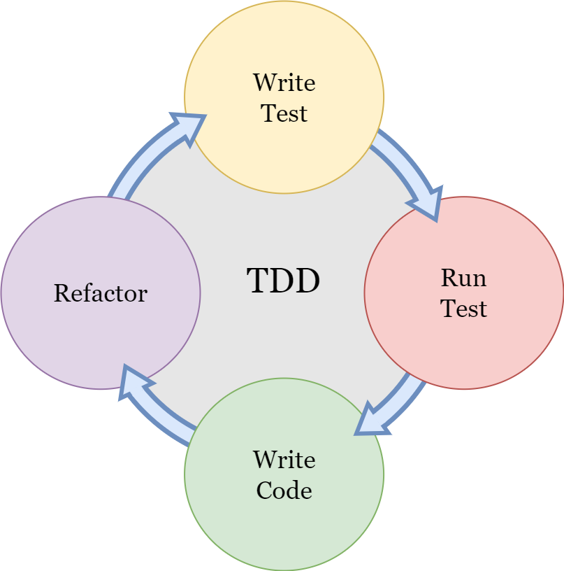

Last week I was reading about a research done with 3 different groups. The first group had to write an essay without using any tool, the second group could use a search engine to help writing the essay and the third group could use ChatGPT. The group that wrote the essay with ChatGPT was the only group that didn't know what their own essays said. Coincidentally enough, just the other day I listened someone say during a tech talk about AI "I already wrote code that I don't know 100% what is doing". I mean, with AI Agents is really easy to generate hundreds of lines of code that you validate some stuff at the end and kinda don't know what the middle is doing.

Just a few years ago internal quality of the code was something **really** serious. I don't know if its because of my mind being very quality focused since the beginning of my journey in Software Engineering but I always took tests really serious. And I think now we need to go back to being very strict about internal quality and advocating even more for a very tested code.

Well, we can't ignore that these tools are a reality right now but we can choose wisely.


Since AI assisted coding started to be a thing I saw a potential to increase unit tests coverage with it and since I do use Claude CLI I decided to experiment a pair programming session with defined roles:

> You and I are now in a pair programming session and we are using TDD as our code methodology. You will be responsible for the test implementation and I'll be responsible to implement the code that makes the test pass.

Claude understood the role, learned what I had implemented (which was nothing really, just started the project with `uv` and added the `pytest` dependency). From `pyproject.toml` description Claude understood the project was going to be a "mini-linux utils library" written in Python. I explained we were going to start with `/mini-grep`:

> Let's start with mini-grep. The usage of mini-grep is ./mini-grep [-q] -e PATTERN [FILE...] mini-grep goes through every argument in FILE and prints the whole line in which PATTERN is found. By default `mini-grep` also outputs the line number of each printed line.
>- PATTERN has to be a valid regex
>- FILE can be zero or more arguments. If zero args are given,
>  `mini-grep` will parse entries from the standard input.
>- If given, the `-q` options only outputs lines but omits the matching line numbers.

After that Claude generated a failing test.

```bash
● Write(/home/acabista/Documents/automations/utilszinho/tests/test_
       mini_grep.py)
  ⎿  Wrote 26 lines to /home/acabista/Documents/automations/ut
     lszinho/tests/test_mini_grep.py
     import pytest
     import re
     from io import StringIO


     class TestMiniGrep:
         """Test suite for mini-grep functionality using TDD 
     approach"""

         def 
     test_search_pattern_in_single_line_with_line_number(self):
             """
             RED: First test - search for a pattern in text and
      return line with line number

             Given a simple text with one matching line
             When searching for a pattern
             Then it should return the line number and the 
     matching line
             """
             from utilszinho.mini_grep import mini_grep

             text = StringIO("hello world\n")
             pattern = "world"

             result = mini_grep(pattern=pattern, file_obj=text,
      show_line_numbers=True)

             expected = "1:hello world"
             assert result == [expected]
```

Let's recap TDD: *Test-driven development* is that methodology of writing a <span style="color:red">red test</span> first, which is basically a test that we know that fails. After that we write just enough code to make the test <span style="color:green">green</span>. After the test is passing we can **refactor** both the test and the code. Then writing another failing test, and writing just enough code to make it pass. And refactor. And failing test. Make it pass. Refactor.



Let's analyze the test Claude generated: it basically import a function `mini_grep` inside a `mini_grep` module that lives in a `utilszinho` directory. Also, the test is passing 3 arguments for the function `mini_grep(pattern=pattern, file_obj=text, show_line_numbers=True)` and asserting that the result is a list of string with a number indicating the line and a line.

After implementing the test, Claude runs to check if it is in fact failing. Also, it gives a few tips on what to do next:

```bash
● Perfect! We have our RED test - it's failing because the
  module doesn't exist yet.

  🔴 RED Phase Complete

  The test is failing with:
  ModuleNotFoundError: No module named 'utilszinho'

  Your turn! Make this test pass by creating the minimal
  implementation. You need to:

  1. Create the utilszinho package structure (directory +
  __init__.py)
  1. Create utilszinho/mini_grep.py with a mini_grep() function
  2. Make it accept pattern, file_obj, and show_line_numbers
  parameters
  1. Return a list with one string: "1:hello world" for this
  simple case

  Go ahead and implement just enough code to make this first
  test pass!
```

But yeah the minimal code necessary to make this test pass is creating the directory with the files, add `__init__.py` files where needed and creating a function that received those parameters and returned the list `[1:hello world]`.

After that I let Claude know that he could run the test.

```bash
🟢 GREEN! First test passes!

  Excellent work! Now let's add the next test to drive more
  functionality. Let me add a test for multiple matching lines:

● Read(tests/test_mini_grep.py)
  ⎿  Read 26 lines

● Update(tests/test_mini_grep.py)
  ⎿  Updated tests/test_mini_grep.py with 18 additions      
       23    
       24            expected = "1:hello world"
       25            assert result == [expected]
       26 +  
       27 +      def test_search_pattern_in_multiple_lines_w
          + ith_line_numbers(self):
       28 +          """
       29 +          RED: Test matching pattern across 
          + multiple lines
       30 +  
       31 +          Given text with multiple lines where 
          + some match the pattern
       32 +          When searching for a pattern
       33 +          Then it should return all matching 
          + lines with their line numbers
       34 +          """
       35 +          from utilszinho.mini_grep import 
          + mini_grep
       36 +  
       37 +          text = StringIO("first line\nhello 
          + world\nthird line\nhello universe\n")
       38 +          pattern = "hello"
       39 +  
       40 +          result = mini_grep(pattern=pattern, 
          + file_obj=text, show_line_numbers=True)
       41 +  
       42 +          expected = ["2:hello world", "4:hello 
          + universe"]
       43 +          assert result == expected
```

After checking that the code is passing, it already implements the second test. Did you notice we completely crossed the *Refactoring* phase? Yeah there's not much code to refactor so I didn't bothered about that. After the 7 first tests, Claude actually reminded me and we stopped to refactor. I said Claude was responsible to refactor only the tests and I was responsible to refactor the production code.

Now moving forward there are two tests and after the changes in the production code, the code must be green for both of them. Without giving me any code tips, Claude again creates a type of TODO list that the code should do. 

```bash
● 🔴 RED Phase - Second Test

  Perfect! The new test is failing. The current implementation
  only returns the hardcoded first result, but it needs to:

  1. Actually read through all lines in the file object
  2. Check each line against the pattern
  3. Track line numbers correctly
  4. Return all matching lines

  Your turn! Update the implementation to make both tests pass.
   You'll need to:
  - Iterate through the file object
  - Use the pattern to match lines (regex or simple string
  search)
  - Track the line number
  - Return all matches with their line numbers
```

In order to implement the minimum code necessary to make this test pass I just checked if the string was in the line `if pattern in line` and if it was, I would append it to a list of `<number>:<content>`. Here I commited a mistake, I was getting a file object and trying to iterate over it again using a context manager. I asked Claude to run the tests against the implemented code and

```bash
● Ah! The issue is that your implementation is trying to open()
   the file_obj, but the test is passing a StringIO object
  (which is already an open file-like object).

  The function signature shows file_obj: str but it should
  accept a file-like object (like StringIO). You need to:

  1. Fix the type hint: file_obj should be something like
  TextIO or just remove the type hint
  2. Don't call open() on it - just iterate over it directly
  since it's already a file-like object

  The file_obj is already open and ready to read, so you can
  just iterate:
  for line in file_obj:
      # process each line

  Update your implementation to handle file-like objects
  correctly!

```

And here I noticed that this pairing session was actually really useful and could be a great tool for people that are just now starting to code.

For a person beggining to code, having an issue that you have no idea how to solve can be extremelly frustrating.

`"Oh but I learned to code writing code in paper"`.

Well me too. I often remember when I was studying Aerospace Engineering and my Algorithms Professor was making us write C++ code in a paper as part of a graded assignment. It was completely unpleasent. Now the new programmers can start writing code from the beginning with design oriented by tests and when an Agent runs the test suite and finds out an issue with the code, it can help by **translating the TypeError to a better format**, organizing the assertion error to a well-written English paragraph.

```bash
pattern = 'hello'
file_obj = <_io.StringIO object at 0x7f37f1c27c40>
show_line_numbers = True

    def mini_grep(pattern: str, file_obj: str, show_line_numbers: bool) -> str:
>       with open(file_obj, 'r') as file:
             ^^^^^^^^^^^^^^^^^^^
E       TypeError: expected str, bytes or os.PathLike object, not StringIO

```

OK I won't add the whole pairing session here, but you can see the result in [this](https://github.com/andressadotpy/utilszinho) repository.

Overall I had a good experience with the TDD pairing session. It was slower than asking Claude to generate the whole code for me, but

- I know 100% about what my code does
- I know 100% about what my tests are testing

And I think that sums it up!